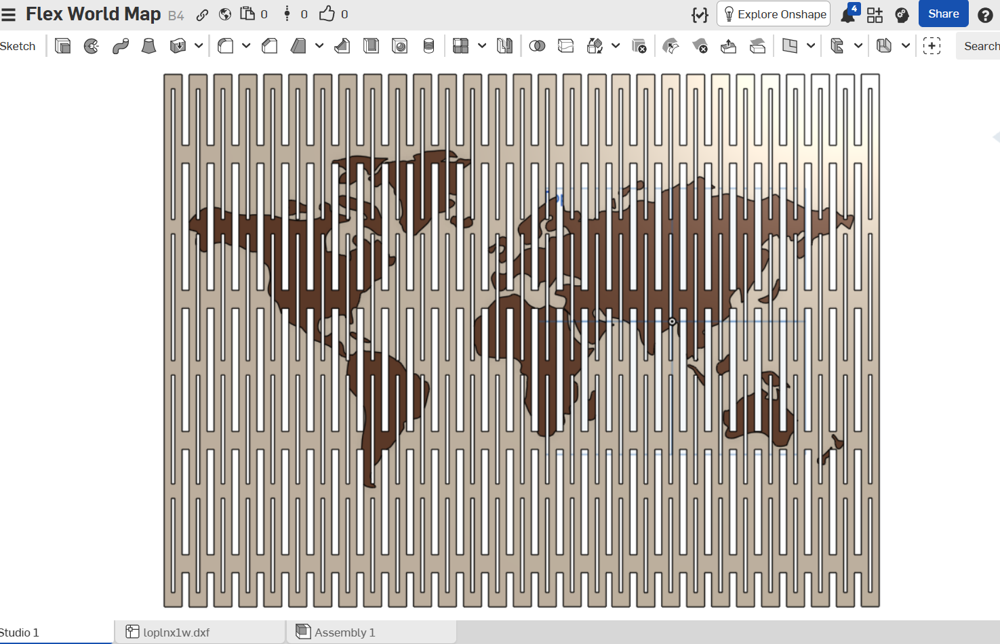

# flexi world map

a world map that bends, rolls up, and lays flat. every strip is its own tile
joined by 2mm live-printed hinges, so the whole thing prints in one piece and
comes off the plate flexible — no assembly, No frame, no stiff plaque.

## why

normal maps are dead weight. they need a frame, they sit in one place
forever, and if you move they crack. i wanted one i could roll up and put in
a bag like a real old paper map. and more than that i wanted to model it
myself instead of downloading one — figure out the projection, get the hinge
geometry right, make something that's both printable AND bends.

## what i actually did

modeled from scratch in onshape (onshape public link below). base is 1cm
strips with 2mm slits, map layer is unioned onto it with matching slits so
the whole part flexes as one. the map file itself was a journey — i went
through a pile of broken dxf/svg/txt files (dots, open loops, fused paths)
and had to hand-fix coastlines before finding a clean one. more on that in
the journal.

## print

- 0.20mm layers, slow first layer (hinges depend on it)
- filament change at the sea-level layer — wood color base, coffee brown land
- no supports, no brim
- single extruder is fine, no AMS needed

## credit

the flexible-map concept is inspired by glennovits' flexi world map on
makerworld — the idea, not the file. this model is my own geometry, drawn
from a messy pile of public map data and a lot of hand-fixing at midnight.

## links

- onshape public model: <paste link>
- timelapse: on the half life entry

---

made for half life week 2 (CAD). it's a day late and i love it anyway.